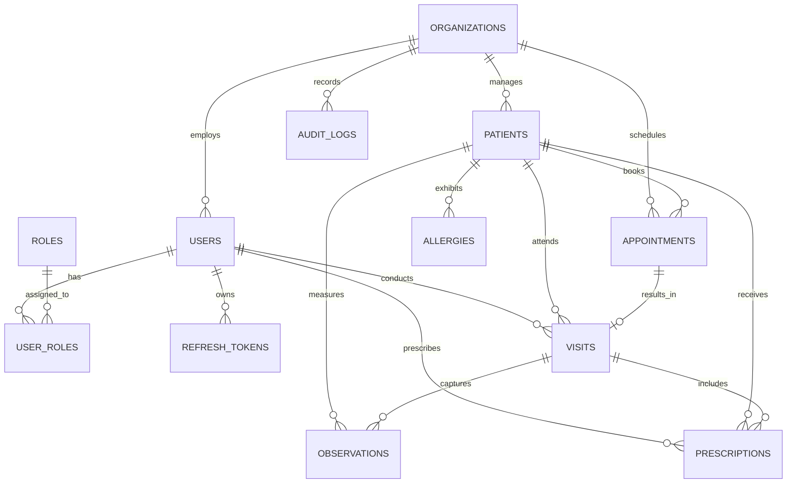

# Clinora — Formal System Requirements Specification (SRS) & Database Architecture Document

**Document Version:** 1.0.0  
**Status:** Approved Engineering Baseline  
**Classification:** Core System Architecture & Requirements  
**Standard Compliance:** ISO/IEC/IEEE 29148 / IEEE 830 / Clean Architecture  

---

## 1. Executive Summary & System Scope

### 1.1 Project Purpose
**Clinora** is an enterprise-grade Clinical Information System, Electronic Health Record (EHR), and Practice Management platform engineered for private specialty clinics, multi-doctor outpatient practices, and ambulatory healthcare centers. 

The platform bridges two distinct operational workflows:
1. **The Provider Clinical Web Portal (React + TypeScript)**: A high-density clinical workstation designed for physicians, clinical assistants (nurses), and administrative staff to manage longitudinal medical records, execute consultation encounters using structured clinical notes (SOAP), track vital observations, issue prescriptions, and handle clinic operations.
2. **The Patient Mobile Companion App (Flutter)**: A cross-platform mobile client (iOS/Android) empowering patients to manage appointments, access verified prescriptions and lab results, track vital metrics, and communicate with their designated clinic.
3. **The Central Clinical Core Engine (FastAPI + Async SQLAlchemy + PostgreSQL)**: A multi-tenant, audited, HIPAA/GDPR-compliant RESTful backend serving both clients via standard JSON contracts, shared business logic, and strict tenant data isolation.

### 1.2 Medical Safety Boundary & Ethical Principles
Clinora operates as an **Assistive Clinical Tool**, not an autonomous medical decision system:
* Clinical decisions, diagnoses, and prescriptions remain the sole legal responsibility of the licensed physician.
* All AI-assisted features (summarization, visit pre-briefing, trend analysis) must be explicitly flagged with an `AI-Generated` watermark and require physician review and signature before being committed to the patient's legal medical record.
* Medical record alterations are strictly prohibited; clinical notes follow append-only semantics with explicit addenda and full non-repudiation auditing.

---

## 2. Stakeholders & Role-Based Access Control (RBAC) Matrix

### 2.1 User Personas

| Role | Client Interface | Primary Operational Responsibilities |
| :--- | :--- | :--- |
| **Clinic Administrator** | Web Portal | Clinic configuration, operating hours, staff invitation, role assignments, audit log review, subscription management. |
| **Physician / Specialist** | Web Portal | Patient chart reviews, encounter SOAP documentation, vital evaluation, prescribing medications, signing off on medical addenda. |
| **Nurse / Medical Assistant** | Web Portal | Patient triage, vital signs intake, patient queue management, prepping encounter charts. |
| **Receptionist / Front Desk** | Web Portal | Patient demographics intake, scheduling/rescheduling appointments, checking in patients, patient check-out. |
| **Patient** | Flutter Mobile App | Appointment self-booking, cancellation, viewing approved prescriptions, viewing personal vital trends, receiving notifications. |

### 2.2 Permissions Matrix

| Capability / Resource | Admin | Doctor | Nurse | Receptionist | Patient (Mobile) |
| :--- | :---: | :---: | :---: | :---: | :---: |
| Manage Clinic Settings & Staff | **CRUD** | — | — | — | — |
| View System Audit Logs | **Read** | — | — | — | — |
| Create / Edit Patient Demographics | **CRUD** | **CRUD** | **CRUD** | **CRUD** | Self-Update Only |
| View Full Longitudinal Medical History | **Read** | **Read** | **Read** (Limited) | — | Self Only (Approved) |
| Create / Sign Clinical Encounters (SOAP) | — | **CRUD** | — | — | — |
| Record Patient Observations / Vitals | — | **CRUD** | **CRUD** | — | Self (Flagged) |
| Issue / Modify Prescriptions | — | **CRUD** | — | — | — |
| View Active Prescriptions | **Read** | **Read** | **Read** | — | Self Only |
| Book / Cancel Appointments | **CRUD** | **CRUD** | **CRUD** | **CRUD** | Self Only |

---

## 3. Cross-Platform Design System & Theme Specification

To deliver an exceptional user experience across both Web and Mobile, Clinora enforces a synchronized design token architecture supporting native Light and Dark modes.

### 3.1 Design System Parity (Web ↔ Flutter)

```
┌────────────────────────────────────────────────────────┐
│              Clinora Design System Tokens              │
├──────────────────────────┬─────────────────────────────┤
│ Web (CSS Variables)      │ Flutter (ThemeData / Colors)│
│ tokens.css               │ AppTheme / AppColorScheme   │
├──────────────────────────┼─────────────────────────────┤
│ --color-brand-500        │ ClinoraColors.brandPrimary  │
│ --color-surface-primary  │ colorScheme.surface         │
│ --color-surface-card     │ colorScheme.surfaceVariant  │
│ --color-text-primary     │ colorScheme.onSurface       │
│ --color-danger-500       │ colorScheme.error           │
│ --color-warning-500      │ ClinoraColors.warning       │
│ --color-success-500      │ ClinoraColors.success       │
└──────────────────────────┴─────────────────────────────┘
```

### 3.2 Visual & Ergonomic Principles
1. **Clinical Legibility**: High-contrast typography (Inter / Roboto) optimized for dense clinical charts and dark examination rooms.
2. **Clinical Severity Accents**:
   - `Normal`: Balanced emerald green (`#10B981` / `success`).
   - `Borderline / Warning`: Amber alert (`#F59E0B` / `warning`).
   - `Critical / Out of Range`: Crimson red (`#EF4444` / `danger`).
3. **Adaptive Themes**:
   - **Light Mode**: Crisp medical white/neutral slate surfaces (`#FFFFFF`, `#F8FAFC`, `#F1F5F9`) preventing glare under fluorescent hospital lighting.
   - **Dark Mode**: Deep obsidian and slate tones (`#0F172A`, `#1E293B`, `#334155`) engineered for low-light consultation suites and OLED mobile displays.

---

## 4. Functional Requirements Specification (FRS)

### Module 1: Multi-Tenancy & Identity Access Management (IAM)
* **FR-IAM-01 (Tenant Isolation)**: The system shall logically isolate all patient, clinical, and operational data per `organization_id`. Cross-tenant queries are structurally prohibited.
* **FR-IAM-02 (Authentication)**: The system shall support secure authentication via email/password. Web clients use HTTP-only, SameSite cookies for refresh token rotation; mobile Flutter clients use Bearer token authorization headers.
* **FR-IAM-03 (Token Family Theft Detection)**: Upon reuse of an already-rotated refresh token, the system shall invalidate the entire token family immediately and write a critical security audit event.
* **FR-IAM-04 (RBAC Enforcement)**: All protected API endpoints must evaluate caller permissions before executing domain operations.

### Module 2: Patient Registration & Longitudinal Records
* **FR-PAT-01 (Demographic Ingestion)**: The system shall record patient identity, including National Identification Number, Full Legal Name, Date of Birth, Biological Sex, Blood Group, Phone, Email, and Emergency Contacts.
* **FR-PAT-02 (Longitudinal Master Patient Index - EMPI)**: Each patient shall be assigned an immutable UUID within the organization. All encounters, vitals, prescriptions, and notes link to this anchor.
* **FR-PAT-03 (Patient Directory & Search)**: The system shall provide sub-50ms search capabilities filtering by name, national ID, or phone number.
* **FR-PAT-04 (Medical Background)**: The system shall store chronic conditions, known drug allergies (with severity ratings), and surgical history.

### Module 3: Clinical Encounters & SOAP Consultation Notes
* **FR-ENC-01 (Encounter Lifecycle)**: Encounters shall transition through states: `IN_PROGRESS` → `COMPLETED` → `SIGNED`.
* **FR-ENC-02 (Structured SOAP Notes)**: Clinical visits must be structured according to SOAP methodology:
  * **Subjective**: Chief complaint, history of present illness (HPI).
  * **Objective**: Physical examination findings and verified vitals.
  * **Assessment**: Working diagnosis, differential diagnoses, and ICD-10 codification.
  * **Plan**: Recommended investigations, therapeutic treatments, follow-up intervals.
* **FR-ENC-03 (Immutability & Addenda)**: Once an encounter is marked `SIGNED` by the physician, it cannot be modified. Clarifications or corrections must be appended as signed timestamped addenda.

### Module 4: Clinical Observations, Vitals & Longitudinal Trends
* **FR-OBS-01 (Standardized Observations)**: The system shall capture numerical and qualitative clinical measurements with strict `type`, `value`, `unit`, and `reference_range` definitions (e.g. Systolic BP: 120 mmHg, Heart Rate: 72 bpm, HbA1c: 5.6 %).
* **FR-OBS-02 (Temporal Tracking)**: Every observation must preserve an accurate `recorded_at` timestamp independent of when it was entered into the database.
* **FR-OBS-03 (Abnormality Flagging)**: The system shall automatically flag measurements falling outside standard physiological reference boundaries.

### Module 5: Prescriptions & Medication Management
* **FR-RX-01 (Prescription Issuance)**: The physician shall be able to issue prescriptions containing medication name, dosage form, strength, route, frequency, duration, total quantity, and patient instructions.
* **FR-RX-02 (Allergy Cross-Check)**: The system shall alert the prescriber if a prescribed drug class matches a documented patient allergy.
* **FR-RX-03 (Digital Document Generation)**: The system shall generate printable and exportable PDF prescriptions containing clinic branding, doctor signature lines, and validation QR codes.

### Module 6: Appointments & Queue Management
* **FR-APT-01 (Scheduling)**: Staff and patients shall be able to schedule appointments for available doctor slots.
* **FR-APT-02 (Status Lifecycle)**: Appointments shall transition through: `SCHEDULED` → `CHECKED_IN` → `IN_CONSULTATION` → `COMPLETED` / `CANCELLED` / `NO_SHOW`.
* **FR-APT-03 (Conflict Prevention)**: The scheduling engine shall prevent double-booking for the same provider during overlapping time windows.

### Module 7: Patient Companion Portal (Flutter Mobile App)
* **FR-MOB-01 (Patient Authentication)**: Patients shall authenticate securely using phone/email OTP or biometric credentials.
* **FR-MOB-02 (Appointment Self-Service)**: Patients shall view available clinic slots, book appointments, and cancel eligible upcoming visits.
* **FR-MOB-03 (Prescription & Records Access)**: Patients shall view doctor-signed prescriptions, instructions, and released laboratory results.
* **FR-MOB-04 (Push Notifications)**: The mobile client shall receive push notifications for appointment confirmations, visit reminders, and prescription refills.

### Module 8: Audit Logging & Regulatory Non-Repudiation
* **FR-AUD-01 (Comprehensive Coverage)**: All authentication attempts, patient chart views, record creations, updates, and exports shall generate an immutable `AuditLog` row.
* **FR-AUD-02 (Audit Context)**: Each log entry must capture: `organization_id`, `actor_id`, `actor_email`, `action`, `resource_type`, `resource_id`, `outcome`, `ip_address`, `user_agent`, `request_id`, and payload delta.

---

## 5. Non-Functional Requirements Specification (NFRS)

* **NFR-SEC-01 (Data Encryption)**: AES-256 encryption at rest for database and backups; TLS 1.3 in transit for all network traffic.
* **NFR-SEC-02 (Password Hashing)**: Passwords hashed with Argon2id or bcrypt (minimum cost factor 12).
* **NFR-PERF-01 (API Latency)**: 95th percentile response latency for core endpoints < 150ms under nominal clinic load.
* **NFR-PERF-02 (Database Indexing)**: All foreign keys (`organization_id`, `patient_id`, `visit_id`) and temporal sorting keys (`created_at`, `scheduled_time`) must be explicitly indexed.
* **NFR-REL-01 (Transaction Atomicity)**: Complex multi-entity operations (e.g. visit completion + vital logging + prescription generation + audit recording) must execute inside ACID transactions.
* **NFR-ACC-01 (Accessibility)**: Full compliance with WCAG 2.1 Level AA standards across all web interface controls.

---

## 6. Comprehensive Database Architecture & Entity-Relationship Model

### 6.1 Entity-Relationship Overview (Mermaid)



### 6.2 Relational Data Dictionary

#### 1. Core Tenancy & IAM
* **`organizations`**: Clinic entity anchor.
  * `id` (UUID, PK), `name` (VARCHAR 255), `slug` (VARCHAR 100, UNIQUE), `phone` (VARCHAR 50), `address` (TEXT), `is_active` (BOOL), `created_at`, `updated_at`.
* **`users`**: Clinic staff and practitioners.
  * `id` (UUID, PK), `organization_id` (UUID, FK → organizations), `email` (VARCHAR 255, UNIQUE), `password_hash` (VARCHAR 255), `full_name` (VARCHAR 255), `is_active` (BOOL), `is_superuser` (BOOL), `created_at`, `updated_at`.
* **`roles`**: System roles (`ADMIN`, `DOCTOR`, `NURSE`, `RECEPTIONIST`).
  * `id` (UUID, PK), `name` (VARCHAR 50, UNIQUE), `description` (TEXT).
* **`user_roles`**: Many-to-many junction.
  * `user_id` (UUID, FK → users, PK), `role_id` (UUID, FK → roles, PK), `assigned_at` (TIMESTAMPTZ).
* **`refresh_tokens`**: Rotating session security tokens.
  * `id` (UUID, PK), `user_id` (UUID, FK → users), `token_hash` (VARCHAR 255, UNIQUE), `family_id` (UUID), `issued_at`, `expires_at`, `revoked_at`, `ip_address`, `user_agent`.
* **`audit_logs`**: Immutable regulatory trail.
  * `id` (UUID, PK), `organization_id` (UUID, FK → organizations), `actor_id` (UUID, NULLABLE), `actor_email` (VARCHAR 255), `action` (VARCHAR 100), `resource_type` (VARCHAR 100), `resource_id` (VARCHAR 255), `outcome` (VARCHAR 10), `request_id` (UUID), `ip_address` (INET), `user_agent` (TEXT), `metadata` (JSONB), `created_at` (TIMESTAMPTZ).

#### 2. Clinical Core (Phase 2)
* **`patients`**: Master patient index.
  * `id` (UUID, PK)
  * `organization_id` (UUID, FK → organizations.id ON DELETE RESTRICT)
  * `national_id` (VARCHAR 50, NULLABLE)
  * `full_name` (VARCHAR 255 NOT NULL)
  * `date_of_birth` (DATE NOT NULL)
  * `gender` (VARCHAR 20 NOT NULL) — `MALE`, `FEMALE`, `OTHER`
  * `blood_type` (VARCHAR 10 NULLABLE) — `A+`, `A-`, `B+`, `B-`, `AB+`, `AB-`, `O+`, `O-`
  * `phone` (VARCHAR 50 NOT NULL)
  * `email` (VARCHAR 255 NULLABLE)
  * `address` (TEXT NULLABLE)
  * `emergency_contact_name` (VARCHAR 255 NULLABLE)
  * `emergency_contact_phone` (VARCHAR 50 NULLABLE)
  * `is_active` (BOOLEAN DEFAULT TRUE)
  * `created_at` (TIMESTAMPTZ DEFAULT now())
  * `updated_at` (TIMESTAMPTZ DEFAULT now())
  * *Indexes*: `(organization_id, full_name)`, `(organization_id, phone)`, `(organization_id, national_id)`.

* **`allergies`**: Documented patient adverse reactions.
  * `id` (UUID, PK)
  * `organization_id` (UUID, FK → organizations)
  * `patient_id` (UUID, FK → patients.id ON DELETE CASCADE)
  * `allergen` (VARCHAR 255 NOT NULL) — e.g. "Penicillin", "Peanuts"
  * `severity` (VARCHAR 20 NOT NULL) — `MILD`, `MODERATE`, `SEVERE`, `LIFE_THREATENING`
  * `reaction` (TEXT NULLABLE) — e.g. "Anaphylaxis", "Urticaria"
  * `recorded_at` (TIMESTAMPTZ DEFAULT now())

* **`appointments`**: Scheduling and queue management.
  * `id` (UUID, PK)
  * `organization_id` (UUID, FK → organizations)
  * `patient_id` (UUID, FK → patients.id ON DELETE CASCADE)
  * `doctor_id` (UUID, FK → users.id ON DELETE RESTRICT)
  * `scheduled_time` (TIMESTAMPTZ NOT NULL)
  * `duration_minutes` (INTEGER DEFAULT 30)
  * `status` (VARCHAR 30 NOT NULL DEFAULT 'SCHEDULED') — `SCHEDULED`, `CONFIRMED`, `CHECKED_IN`, `IN_CONSULTATION`, `COMPLETED`, `CANCELLED`, `NO_SHOW`
  * `reason_for_visit` (TEXT NULLABLE)
  * `cancellation_reason` (TEXT NULLABLE)
  * `created_at`, `updated_at`
  * *Indexes*: `(organization_id, doctor_id, scheduled_time)`, `(organization_id, patient_id)`.

* **`visits` (Encounters)**: Clinical consultations and SOAP notes.
  * `id` (UUID, PK)
  * `organization_id` (UUID, FK → organizations)
  * `patient_id` (UUID, FK → patients.id ON DELETE RESTRICT)
  * `doctor_id` (UUID, FK → users.id ON DELETE RESTRICT)
  * `appointment_id` (UUID, FK → appointments.id NULLABLE)
  * `visit_date` (TIMESTAMPTZ NOT NULL DEFAULT now())
  * `status` (VARCHAR 20 NOT NULL DEFAULT 'IN_PROGRESS') — `IN_PROGRESS`, `COMPLETED`, `SIGNED`
  * `chief_complaint` (TEXT NOT NULL)
  * `subjective_notes` (TEXT NULLABLE) — Patient-reported narrative
  * `objective_notes` (TEXT NULLABLE) — Physical exam findings
  * `assessment_notes` (TEXT NULLABLE) — Clinical evaluation & ICD-10 notes
  * `plan_notes` (TEXT NULLABLE) — Medical plan, investigations, advice
  * `signed_at` (TIMESTAMPTZ NULLABLE)
  * `created_at`, `updated_at`
  * *Indexes*: `(organization_id, patient_id, visit_date)`, `(organization_id, doctor_id)`.

* **`observations`**: Quantitative & qualitative clinical measurements.
  * `id` (UUID, PK)
  * `organization_id` (UUID, FK → organizations)
  * `patient_id` (UUID, FK → patients.id ON DELETE CASCADE)
  * `visit_id` (UUID, FK → visits.id NULLABLE ON DELETE SET NULL)
  * `recorded_by_id` (UUID, FK → users.id NULLABLE)
  * `type` (VARCHAR 50 NOT NULL) — `BLOOD_PRESSURE_SYS`, `BLOOD_PRESSURE_DIA`, `HEART_RATE`, `RESPIRATORY_RATE`, `BODY_TEMPERATURE`, `OXYGEN_SATURATION`, `WEIGHT`, `HEIGHT`, `BMI`, `BLOOD_GLUCOSE`
  * `value` (NUMERIC(10, 2) NOT NULL)
  * `unit` (VARCHAR 30 NOT NULL) — e.g. `mmHg`, `bpm`, `celsius`, `%`, `kg`, `cm`, `mg/dL`
  * `is_abnormal` (BOOLEAN DEFAULT FALSE)
  * `recorded_at` (TIMESTAMPTZ NOT NULL DEFAULT now())
  * *Indexes*: `(organization_id, patient_id, type, recorded_at)`.

* **`prescriptions`**: Pharmacotherapy directives.
  * `id` (UUID, PK)
  * `organization_id` (UUID, FK → organizations)
  * `patient_id` (UUID, FK → patients.id ON DELETE RESTRICT)
  * `visit_id` (UUID, FK → visits.id ON DELETE RESTRICT)
  * `doctor_id` (UUID, FK → users.id ON DELETE RESTRICT)
  * `medication_name` (VARCHAR 255 NOT NULL)
  * `dosage` (VARCHAR 100 NOT NULL) — e.g. "500 mg"
  * `route` (VARCHAR 50 NOT NULL DEFAULT 'ORAL') — `ORAL`, `INTRAVENOUS`, `TOPICAL`, `INHALATION`
  * `frequency` (VARCHAR 100 NOT NULL) — e.g. "TDS (Every 8 hours)"
  * `duration` (VARCHAR 100 NOT NULL) — e.g. "7 days"
  * `instructions` (TEXT NULLABLE) — e.g. "Take after food with full glass of water"
  * `is_active` (BOOLEAN DEFAULT TRUE)
  * `issued_at` (TIMESTAMPTZ DEFAULT now())
  * *Indexes*: `(organization_id, patient_id, is_active)`, `(organization_id, visit_id)`.

---

## 7. Client Ecosystem & Integration Architecture

```
                  ┌──────────────────────────────────────────────┐
                  │                 PostgreSQL 16                │
                  │   Multi-tenant Schema with Organization FKs  │
                  └──────────────────────▲───────────────────────┘
                                         │
                                         │ AsyncPG / SQLAlchemy 2.0
                                         │
                  ┌──────────────────────┴───────────────────────┐
                  │             Clinora Backend API              │
                  │    FastAPI + Clean Hexagonal Architecture    │
                  └──────────────▲────────────────▲──────────────┘
                                 │                │
            JSON / HTTP-Only Cookies              │ JSON / Bearer JWT
                                 │                │
          ┌──────────────────────┴───────┐   ┌────┴─────────────────────────┐
          │     Provider Web Portal      │   │    Patient Companion App     │
          │   React + TypeScript + Vite  │   │       Flutter (iOS/Android)  │
          │──────────────────────────────│   │──────────────────────────────│
          │ • Doctor Consultation Desk   │   │ • Appointment Self-Booking   │
          │ • Clinical SOAP Documentation│   │ • Active Prescriptions View  │
          │ • Longitudinal Charts/Vitals │   │ • Lab Reports & Observations │
          │ • Receptionist Scheduling    │   │ • Push Visit Notifications   │
          └──────────────────────────────┘   └──────────────────────────────┘
```

---

## 8. Development Standards & Architectural Invariants

1. **Repository & Service Pattern**:
   - Route handlers **never** write direct ORM queries.
   - Operations spanning multiple tables or writing audit events belong in an Application Service (`application/clinical/patient_service.py`).
2. **DTO Purity**:
   - ORM models are internal to the persistence layer. The API contract strictly consumes and emits Pydantic schemas.
3. **Audit Invariant**:
   - No clinical entity is ever deleted silently. Critical updates write an entry to `audit_logs` with the calling user ID, correlation ID, and state change metadata.
4. **Design Token Synchronicity**:
   - Any new semantic color, elevation, or layout variable added to `styles/tokens.css` must have an equivalent token declared in the Flutter theme definition.
